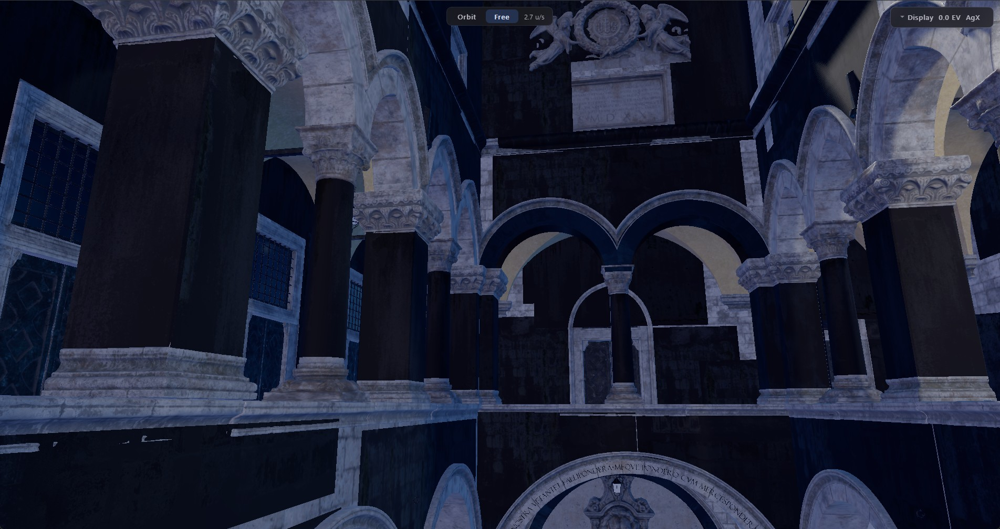
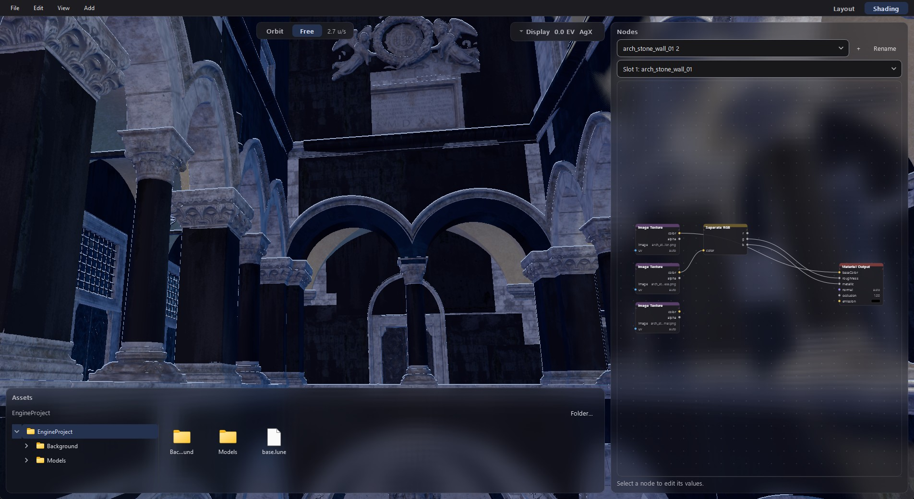

# Lune

A real-time renderer and editor for visual effects, built from scratch in C++20 with Qt 6
and QRhi (Direct3D 11/12, Vulkan, Metal, OpenGL from one set of GLSL shaders).



<sub>Intel's Sponza scene (CC BY 4.0) imported from glTF: its materials become node graphs,
lit by an HDR environment and a sun with contact-hardening shadows.</sub>

Lune is two things: a **physically based renderer** whose shading, lighting and shadows
are written by hand, and an **editor** around it that keeps the interface out of the way.
The viewport fills the window; the few panels float over it as translucent glass, and most
actions are one keystroke or one search in the command palette away.

> **Status:** active development. Rendering: PBR, image-based lighting, shadows and
> textured node materials are done; post-processing, a timeline and GPU particles are next
> (see the [roadmap](docs/roadmap.md)).

## Rendering

Written by the author. How the frame is put together (passes, targets, conventions) is
in [docs/rendering.md](docs/rendering.md).

- **Cook-Torrance BRDF**: GGX distribution, Smith geometry (Schlick-GGX), Schlick Fresnel,
  metallic-roughness workflow, any number of directional and point lights.
- **Image-based lighting** with the split-sum approximation, precomputed on the GPU from an
  HDR image: equirectangular to cubemap, diffuse irradiance convolution, prefiltered
  specular cubemap (one roughness per mip), BRDF integration LUT; blurred environment
  background.
- **Soft shadows** from up to 4 directional and 4 point lights:
  - PCSS (contact-hardening): a blocker search sizes the penumbra from the light's size,
    then a rotated Poisson-disk PCF filters it;
  - cascaded shadow maps for directional lights, with dithered blending across cascades;
  - point lights through cube faces in a shared atlas, with guard borders between faces;
  - normal-offset and slope-scaled bias against acne.
- **HDR pipeline**: linear lighting in a 16-bit float target, exposure, tonemapping with
  Reinhard, ACES (Hill fit) or AgX.
- **Surface model** for node materials: base color, roughness, metallic, normal (from
  normal maps), ambient occlusion and emission.

## Editor and engine

- **Node materials**: a material is a node graph, compiled to GLSL and then to every
  backend at runtime. Node types are plain GLSL functions with a few annotations, so
  adding one means writing one function. Typing a value or changing an image never
  recompiles: values live in a uniform array, images in fixed sampler slots.
- **Textures**: decoded on worker threads, uploaded with full mip chains a few per frame,
  sRGB or linear per image, released when unused; materials draw at once with fallback
  colors while images stream in. Dozens of 4K images load without stalling the editor.
- **glTF 2.0 / GLB and OBJ import**: UVs, tangents (computed when missing), one material
  slot per submesh; glTF materials (base color, metallic-roughness, occlusion, normal,
  emissive) become node graphs, embedded images included.
- **Backend-agnostic rendering** through QRhi; shaders written once in GLSL, compiled for
  every backend at build time (and at runtime for materials).
- **Glass panels** that blur the scene behind them, snap to the window's edges and hide
  with Tab; **workspaces** (Layout, Shading) that remember their panels.
- **Scene editing**: picking, move / rotate / scale gizmo with local and global axes,
  outliner, automatic Inspector built from component descriptors, orbit and free camera.
- **Undo / redo** for every edit, drags merged into one step; **command palette**
  (Ctrl+K) with fuzzy search.
- **Assets browser**, drag and drop of meshes, images and HDR environments.
- **Viewport shading** (Wireframe, Clay, Unlit, Preview, Rendered) and **image renders**:
  the final image (F4) or a set of passes (F6) as PNG files, at any size, without the
  editor's overlays.
- **Scene files** (`.lune`, JSON, paths relative to the scene), a **stats overlay** (F12)
  and **automated tests** for the scene model, undo, file formats, importers, picking,
  gizmo and material compiler.



## Who wrote what

Lune is a personal project, developed with the help of
[Claude Code](https://claude.com/claude-code). The work is split on purpose:

| Part | Written by |
|---|---|
| Shading, lighting, BRDF, image-based lighting shaders | Author |
| Shadow filtering: PCF, PCSS, cascade selection and blending | Author |
| HDR display pass and tonemapping | Author |
| Material nodes for shading (normal map, noise, ...) | Author |
| GPU resource plumbing (render targets, atlases, cascades fitting, bindings) | Claude, with the author's review |
| Editor UI, panels, gizmo, Inspector, undo, command palette | Claude |
| Node material system: graph model, editor, GLSL codegen, texture cache | Claude |
| Importers, scene format, build scripts, tests, documentation | Claude |

Every item of the [roadmap](docs/roadmap.md) says who writes it. In the shaders the author
owns, Claude only adds declarations (uniforms, bindings) and comments.

## Building

### Requirements

| | Version | Notes |
|---|---|---|
| Windows | 10 / 11 | The build scripts are Windows-only; the code itself is portable. |
| Visual Studio | 2022, *Desktop development with C++* | Provides MSVC, Ninja and CMake. |
| Qt | 6.8.1, `msvc2022_64` | Modules: Qt Base and **Qt Shader Tools**. |
| CMake | 3.22+ | The one shipped with Visual Studio works. |
| Git | any | Used to download third-party libraries at configure time. |

Qt is expected in `C:/Qt/6.8.1/msvc2022_64`; change `CMAKE_PREFIX_PATH` in
[`CMakePresets.json`](CMakePresets.json) if yours is elsewhere. If Qt Shader Tools is
missing, add it with the Qt Maintenance Tool, or with
[aqtinstall](https://github.com/miurahr/aqtinstall):

```bat
python -m aqt install-qt windows desktop 6.8.1 win64_msvc2022_64 -m qtshadertools --noarchives --outputdir C:\Qt
```

### Build and run

```bat
run.bat                 :: configure, build, then start Lune (only if the build succeeded)
run.bat scene.lune      :: same, opening a scene
test.bat                :: build and run all tests
test.bat -R sceneio     :: only the tests whose name contains "sceneio"
```

The scripts find Visual Studio with `vswhere` and load its environment, so they work
from a plain command prompt or a double-click. To build by hand from a
*x64 Native Tools Command Prompt for VS 2022*:

```bat
cmake --preset default
cmake --build build
ctest --test-dir build --output-on-failure
```

Third-party libraries are downloaded on the first configure into `build/_deps`
(see [`cmake/dependencies.cmake`](cmake/dependencies.cmake)).

## Using the editor

### Mouse

| Action | Input |
|---|---|
| Select | Left click on an object (empty space deselects) |
| Move / rotate / scale | Left drag on a gizmo handle; right click while dragging cancels |
| Move in the view plane / uniform scale | Left drag on the gizmo's center |
| Orbit | Right drag |
| Pan | Middle drag |
| Zoom | Wheel |
| Orbit / free camera | Bar at the top of the viewport, or View > Free Camera |
| Free camera: look / fly | Hold right button + move the mouse; W A S D, Q / E down / up, Shift faster |
| Free camera: speed / move | Wheel while holding the right button / wheel alone moves forward and back |
| Scrub a value | Drag a property's label (Shift = fine, Ctrl = coarse) |
| Move a panel | Drag its title; it snaps to the nearest edge |
| Resize a panel | Drag its inner edge (the one facing the viewport) |
| Add a mesh / open a scene | Double-click it in the Assets panel |
| Place a mesh / set the environment | Drag a mesh or an `.hdr` from the Assets panel (or the file manager) onto the viewport |
| Exposure / tonemapping | Display menu, top-right corner of the viewport (drag "exposure" to scrub) |

### Keyboard

| Shortcut | Action |
|---|---|
| Ctrl+K | Command palette |
| Tab | Hide / show the panels and the viewport's bars (mouse over the viewport) |
| Shift+A | Add menu at the cursor (empty, cube, sphere, plane, lights, environment, import) |
| W / E / R | Move / rotate / scale gizmo |
| T | Gizmo axes: global / local (scale always uses the entity's axes) |
| Delete | Delete the selection |
| F2 / double click | Rename in the outliner |
| Ctrl+Z / Ctrl+Y | Undo / redo (also Ctrl+Shift+Z) |
| Ctrl+N / Ctrl+O / Ctrl+S / Ctrl+Shift+S | New / open / save / save as |
| Ctrl+I | Import mesh (OBJ, glTF, GLB) |
| Shift+Alt+Z | Editor overlays on / off: grid lines, light icons, gizmo, selection outline (View > Overlays), for clean screenshots |
| F4 | Render the image (PNG in `renders/` next to the scene) |
| F6 | Render the passes chosen in Render > Render Settings, one PNG each |
| F12 | Stats overlay |

## Project layout

```
src/
  engine/              no Qt Widgets: usable by the editor, tests and future tools
    scene/             entities, transforms, meshes, component descriptors, picking
    io/                scene files, OBJ and glTF loaders
    render/            Renderer, camera, shaders/
  frontend/            the editor (Qt Widgets)
    core/              selection and undo commands
    components/        viewport + gizmo, panels (inspector, outliner, assets), palette, widgets
    theme/             palette and stylesheet
tests/                 Qt Test suites, one executable per tst_*.cpp
cmake/                 third-party dependencies
scripts/               build helpers used by run.bat and test.bat
docs/                  documentation
```

## Documentation

- [Architecture](docs/architecture.md): layers, how an edit flows through the editor, design decisions.
- [Rendering](docs/rendering.md): the frame, the glass blur, coordinate conventions, shaders.
- [Node materials](docs/materials.md): the Shading workspace, how graphs become shaders, writing nodes.
- [Scene file format](docs/scene-format.md): the `.lune` specification.
- [Extending Lune](docs/extending.md): adding components, actions, file formats, shaders, dependencies, tests.
- [Troubleshooting](docs/troubleshooting.md): common build problems.
- [Roadmap](docs/roadmap.md): planned features and who writes each part.

## Third-party

- [Qt 6](https://www.qt.io/) (LGPLv3, linked dynamically): UI, QRhi rendering, shader tools.
- [cgltf](https://github.com/jkuhlmann/cgltf) (MIT): glTF 2.0 parsing.

The screenshots show Intel's [Sponza](https://www.intel.com/content/www/us/en/developer/topic-technology/graphics-research/samples.html)
sample scene (CC BY 4.0), which is not part of this repository.

Techniques adapted in the shaders (`src/engine/render/shaders/display.frag`):

- **ACES tonemapping**: fit by Stephen Hill, from
  [BakingLab](https://github.com/TheRealMJP/BakingLab/blob/master/BakingLab/ACES.hlsl) (MIT, Copyright (c) 2016 MJP).
- **AgX tonemapping**: the display transform by [Troy Sobotka](https://github.com/sobotka/AgX),
  in the minimal polynomial fit by Benjamin Wrensch,
  [Minimal AgX Implementation](https://iolite-engine.com/blog_posts/minimal_agx_implementation).

## License

Lune is released under the [MIT License](LICENSE). Copyright (c) 2026 Stefano Russo.
