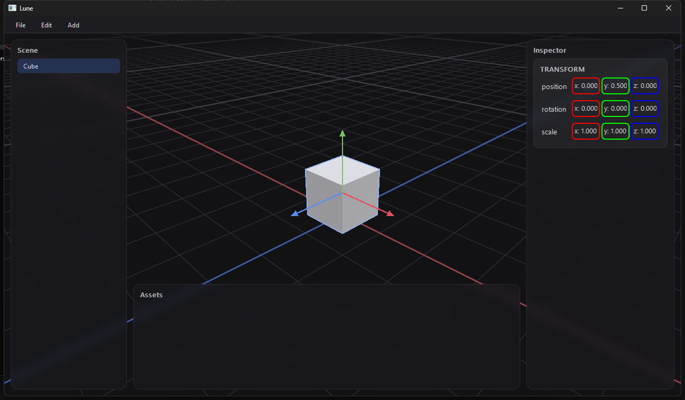

# Lune

A real-time renderer and editor for visual effects, built with C++20, Qt 6 and QRhi.

Lune keeps the interface as small as possible: the viewport fills the window, and the
few panels float over it as translucent glass, with the scene blurred behind them.
Most actions are one keystroke or one search in the command palette away.



> **Status:** early development. The editor foundations are in place (scene, selection,
> undo, gizmo, files, tests); the rendering and VFX core is what comes next.

## Features

- **Backend-agnostic rendering** through QRhi: Direct3D 11/12, Vulkan, Metal, OpenGL.
  Shaders are written once in GLSL and compiled for every backend at build time.
- **Infinite world grid**, shaded meshes with depth, selection outline.
- **Glass panels**: floating, draggable panels that snap to the left, right or bottom
  edge; the viewport renders a blurred copy of the scene behind them.
- **Scene editing**: click to select, move / rotate / scale gizmo, outliner, rename.
- **Automatic Inspector**: built from component descriptors, one editor per property
  type; drag a property's label to scrub its value.
- **Undo / redo** for every edit; drags collapse into a single step.
- **Command palette** (Ctrl+K) with fuzzy search over every action.
- **Scene files** (`.lune`, JSON) and mesh import (OBJ, glTF 2.0 / GLB).
- **Lights and PBR shading**: directional and point lights, Cook-Torrance materials
  (roughness, metallic); shadow maps for up to 4 directional and 4 point lights.
- **Image-based lighting**: an Environment from an HDR image (`.hdr`) or a sky/ground
  gradient, precomputed on the GPU into irradiance and prefiltered cubemaps; optionally
  shown as the background.
- **HDR viewport**: linear lighting in a 16-bit float scene, with exposure and tonemapping
  chosen from the Display menu in the viewport corner.
- **Stats overlay** (F12): FPS, CPU frame time, draw calls, triangles.
- **Automated tests** for the scene model, undo, file formats, picking and gizmo.

## Building

### Requirements

| | Version | Notes |
|---|---|---|
| Windows | 10 / 11 | The build scripts are Windows-only; the code itself is portable. |
| Visual Studio | 2022, *Desktop development with C++* | Provides MSVC, Ninja and CMake. |
| Qt | 6.8.1, `msvc2022_64` | Modules: Qt Base and **Qt Shader Tools**. |
| CMake | 3.22+ | The one shipped with Visual Studio works. |
| Git | any | Used to download third-party libraries at configure time. |

Qt is expected in `C:/Qt/6.8.1/msvc2022_64`; change `CMAKE_PREFIX_PATH` in
[`CMakePresets.json`](CMakePresets.json) if yours is elsewhere. If Qt Shader Tools is
missing, add it with the Qt Maintenance Tool, or with
[aqtinstall](https://github.com/miurahr/aqtinstall):

```bat
python -m aqt install-qt windows desktop 6.8.1 win64_msvc2022_64 -m qtshadertools --noarchives --outputdir C:\Qt
```

### Build and run

```bat
run.bat                 :: configure, build, then start Lune (only if the build succeeded)
run.bat scene.lune      :: same, opening a scene
test.bat                :: build and run all tests
test.bat -R sceneio     :: only the tests whose name contains "sceneio"
```

The scripts find Visual Studio with `vswhere` and load its environment, so they work
from a plain command prompt or a double-click. To build by hand from a
*x64 Native Tools Command Prompt for VS 2022*:

```bat
cmake --preset default
cmake --build build
ctest --test-dir build --output-on-failure
```

Third-party libraries are downloaded on the first configure into `build/_deps`
(see [`cmake/dependencies.cmake`](cmake/dependencies.cmake)).

## Using the editor

### Mouse

| Action | Input |
|---|---|
| Select | Left click on an object (empty space deselects) |
| Move / rotate / scale | Left drag on a gizmo handle; right click while dragging cancels |
| Orbit | Right drag |
| Pan | Middle drag |
| Zoom | Wheel |
| Scrub a value | Drag a property's label (Shift = fine, Ctrl = coarse) |
| Move a panel | Drag its title; it snaps to the nearest edge |
| Exposure / tonemapping | Display menu, top-right corner of the viewport (drag "exposure" to scrub) |

### Keyboard

| Shortcut | Action |
|---|---|
| Ctrl+K | Command palette |
| Shift+A | Add menu at the cursor (empty, cube, sphere, plane, lights, environment, import) |
| W / E / R | Move / rotate / scale gizmo |
| Delete | Delete the selection |
| F2 / double click | Rename in the outliner |
| Ctrl+Z / Ctrl+Y | Undo / redo (also Ctrl+Shift+Z) |
| Ctrl+N / Ctrl+O / Ctrl+S / Ctrl+Shift+S | New / open / save / save as |
| Ctrl+I | Import mesh (OBJ, glTF, GLB) |
| F12 | Stats overlay |

## Project layout

```
src/
  engine/              no Qt Widgets: usable by the editor, tests and future tools
    scene/             entities, transforms, meshes, component descriptors, picking
    io/                scene files, OBJ and glTF loaders
    render/            Renderer, camera, shaders/
  frontend/            the editor (Qt Widgets)
    core/              selection and undo commands
    components/        viewport + gizmo, panels (inspector, outliner), palette, widgets
    theme/             palette and stylesheet
tests/                 Qt Test suites, one executable per tst_*.cpp
cmake/                 third-party dependencies
scripts/               build helpers used by run.bat and test.bat
docs/                  documentation
```

## Documentation

- [Architecture](docs/architecture.md): layers, how an edit flows through the editor, design decisions.
- [Rendering](docs/rendering.md): the frame, the glass blur, coordinate conventions, shaders.
- [Scene file format](docs/scene-format.md): the `.lune` specification.
- [Extending Lune](docs/extending.md): adding components, actions, file formats, shaders, dependencies, tests.
- [Troubleshooting](docs/troubleshooting.md): common build problems.
- [Roadmap](docs/roadmap.md): planned features and who writes each part.

## Roadmap

1. ~~Editor foundations: scene, selection, undo, gizmo, files~~
2. HDR and shading: PBR, lights, image-based lighting, shadows, textures, color management
3. Post-processing: bloom, depth of field, anti-aliasing
4. Timeline: playback, keyframes, curves
5. GPU particles (compute), emitters and forces
6. Image sequence output (EXR)

The detailed checklist, with who writes each part, is in [docs/roadmap.md](docs/roadmap.md).

## Development and AI assistance

Lune is a personal project, developed with the help of [Claude Code](https://claude.com/claude-code).
So far, the editor infrastructure was written together with Claude: build scripts,
panels and theme, scene model and undo, gizmo and picking, Inspector, command palette,
file formats, tests, stats overlay and this documentation. The rendering and VFX core
(HDR pipeline, shading, particles and simulations) is written by the author.

## Third-party

- [Qt 6](https://www.qt.io/) (LGPLv3, linked dynamically): UI, QRhi rendering, shader tools.
- [cgltf](https://github.com/jkuhlmann/cgltf) (MIT): glTF 2.0 parsing.

Techniques adapted in the shaders (`src/engine/render/shaders/display.frag`):

- **ACES tonemapping**: fit by Stephen Hill, from
  [BakingLab](https://github.com/TheRealMJP/BakingLab/blob/master/BakingLab/ACES.hlsl) (MIT, Copyright (c) 2016 MJP).
- **AgX tonemapping**: the display transform by [Troy Sobotka](https://github.com/sobotka/AgX),
  in the minimal polynomial fit by Benjamin Wrensch,
  [Minimal AgX Implementation](https://iolite-engine.com/blog_posts/minimal_agx_implementation).

## License

Lune is released under the [MIT License](LICENSE). Copyright (c) 2026 Stefano Russo.
