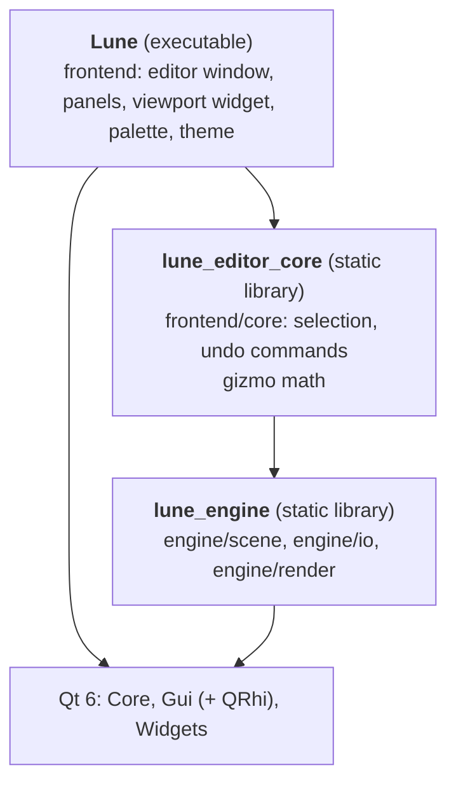
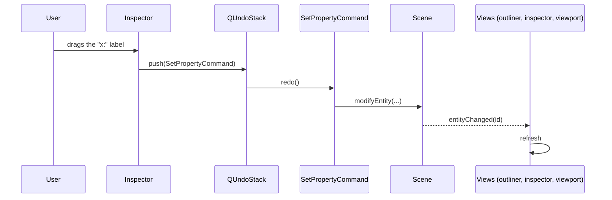

# Architecture

Lune is split in three layers. Each one only depends on the ones below it.



| Layer | Folder | Depends on | Purpose |
|---|---|---|---|
| `lune_engine` | `src/engine` | Qt Core/Gui, cgltf | Scene data, file formats, rendering. **No widgets**, so it can be used by tests and by future tools (e.g. a command-line renderer). |
| `lune_editor_core` | `src/frontend/core`, `gizmo.*` | engine | Editor logic that doesn't need widgets: selection, undo commands, gizmo math. Tested without a UI. |
| `Lune` | `src/frontend` | editor core, Qt Widgets | The editor window and everything visible. |

Includes are relative to `src/`, e.g. `#include "engine/scene/scene.h"`.

## The scene

`Scene` (`engine/scene/scene.h`) is an ordered list of `Entity` values:

```cpp
struct Entity {
    EntityId id;        // stable, never reused within a scene
    QString name;
    Transform transform; // position, rotation (Euler XYZ, degrees), scale
    MeshPtr mesh;        // shared, immutable; nullptr = empty entity
    QColor displayColor;
    bool visible;
};
```

The scene knows nothing about the editor: no selection, no undo. It holds the data and
emits a signal for every change (`entityAdded`, `entityRemoved`, `entityChanged`).
Everything that shows the scene (outliner, inspector, viewport) listens to those signals.

Meshes are immutable and shared through `std::shared_ptr<const Mesh>`: every cube in the
scene uses the same `Mesh`, and the renderer uploads each mesh to the GPU once.
`Mesh::source` records where it came from (`primitive:cube` or a file path) so a saved
scene can find it again.

### Component descriptors

`engine/scene/components.h` describes the entity's data as **components** with typed
**properties** (`Float`, `Vector3`, `Color`, `Bool`, `Text`), each with a getter and a
setter. Three systems are built on them, so a new component needs no code in any of them:

- the **Inspector** creates a section per component and an editor per property;
- the generic **`SetPropertyCommand`** makes any property edit undoable;
- the **scene file** writes and reads every editable property.

See [Extending Lune](extending.md#add-a-component).

## How an edit flows

Panels never modify the scene directly. They describe what the user asked for; the
editor turns it into a command on the undo stack; the command changes the scene; the
scene's signal updates every view.



This is what makes every edit undoable, and it keeps the views consistent: there is one
source of truth and one way to change it.

Commands (`frontend/core/commands.h`):

| Command | Notes |
|---|---|
| `AddEntityCommand` | The id is assigned on the first redo and reused on later redos. |
| `DeleteEntityCommand` | Restores the entity at its old position, with its id and selection. |
| `RenameEntityCommand` | |
| `SetPropertyCommand` | Inspector edits. Consecutive edits of the same property within 600 ms merge into one step; an edit that ends where it started leaves no step. |
| `SetTransformCommand` | Gizmo drags: the scene is updated live during the drag, one command with the explicit "before" state is pushed on release. Never merged. |
| Display change (`DisplayHistory`) | Exposure / tonemapper. Recorded after the change happened (the first redo does nothing), so the menus need no undo code. Exposure changes within 600 ms merge. |

Loading a scene or creating a new one clears the history (it refers to the old scene).
The window title shows `*` while the undo stack isn't at its clean (saved) index.

## Selection

`Selection` (`frontend/core/selection.h`) is editor state, not scene data: one
`EntityId` (single selection for now) and a `changed` signal. Commands that add or
delete entities update it so undo restores what was selected.

## The editor window

`Editor` (`frontend/editor.cpp`) owns the scene, the selection and the undo stack,
creates the panels and connects them. It also owns the file actions (new, open, save).

### Panels

`Panel` (`frontend/components/panel/panel.h`) is a floating frame drawn **over** the
viewport, not a `QDockWidget`: dock widgets can only sit next to the central widget,
never on top of it.

- A top-level panel (parent = viewport) docks to the left, right or bottom edge, keeps a
  margin from the window edges and follows resizes. Dragging its title moves it; on
  release it snaps to the nearest edge. Panels on the same side share the space;
  bottom panels sit between the left and right columns.
- A nested panel (parent = another panel) is laid out by its host: stacked from the top
  when the host is on a side, packed from the left when the host is at the bottom, and
  dragged only along that axis to reorder.
- Panels set the dynamic property `glass = true`, which tells the viewport to blur the
  scene behind them (see [Rendering](rendering.md#glass-panels)).

### Viewport

`Viewport` (`frontend/components/viewport/viewport.h`) is a `QRhiWidget` and a thin
adapter: it owns the camera, the gizmo and the mouse input, collects the glass
rectangles, and delegates all GPU work to `Renderer`.

The **gizmo** is computed in screen space: each frame its handles are projected once,
and the same 2D shapes are drawn (as overlay triangles) and hit-tested. What you see is
exactly what you can grab, and the renderer knows nothing about gizmos.

### Display settings

`DisplaySettings` (`frontend/core/displaysettings.h`) holds the viewport exposure and
tonemapping operator. It's editor state, like the camera, saved in the `editor` section of
the scene file. Unlike the camera it's undoable: `DisplayHistory` records every change on
the undo stack after it happens (exposure scrubs merge into one step), so the settings
also mark the scene as modified and closing asks to save them. The Display menu in the viewport corner
(`DisplayMenu`) and the View menu actions edit it; the viewport passes it to the renderer
every frame.

### Command palette

`CommandPalette` lists every enabled action of the window's menus. Anything added to a
menu shows up in the palette automatically; set the dynamic property
`paletteHidden = true` on an action to leave it out.

## Design decisions

| Decision | Why |
|---|---|
| Floating panels instead of docks | Minimal UI: the viewport always fills the window. |
| Euler angles in `Transform` | Easy to display and edit. A quaternion can be derived when needed; the gizmo rotates one Euler component, exact for single-axis rotations. |
| JSON scene files | Readable, diff-friendly, easy to extend with forward-compatible rules. |
| One mesh per imported file | Simple model for now; a file with several objects is baked into one mesh. |
| Static libraries for engine and editor core | Tests link the real code without a UI. |
| Shaders compiled at build time (qsb) | One GLSL source for every QRhi backend, no runtime compiler. |
