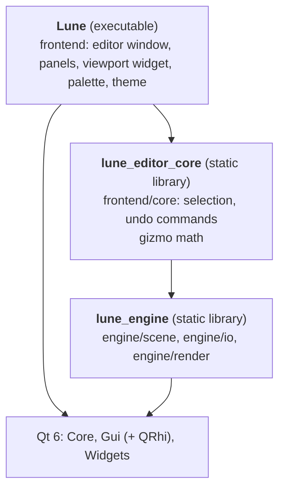
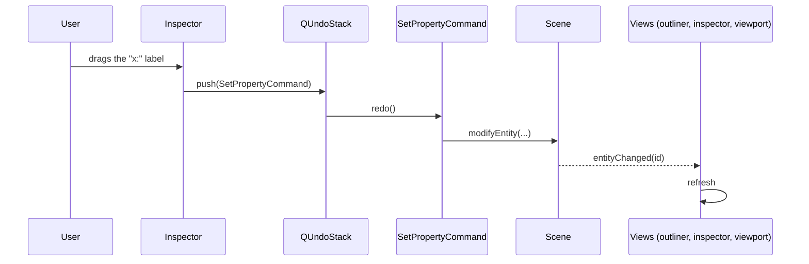

# Architecture

Lune is split in three layers. Each one only depends on the ones below it.



| Layer | Folder | Depends on | Purpose |
|---|---|---|---|
| `lune_engine` | `src/engine` | Qt Core/Gui, cgltf | Scene data, file formats, rendering. **No widgets**, so it can be used by tests and by future tools (e.g. a command-line renderer). |
| `lune_editor_core` | `src/frontend/core`, `gizmo.*` | engine | Editor logic that doesn't need widgets: selection, undo commands, gizmo math. Tested without a UI. |
| `Lune` | `src/frontend` | editor core, Qt Widgets | The editor window and everything visible. |

Includes are relative to `src/`, e.g. `#include "engine/scene/scene.h"`.

## The scene

`Scene` (`engine/scene/scene.h`) is an ordered list of `Entity` values:

```cpp
struct Entity {
    EntityId id;        // stable, never reused within a scene
    QString name;
    Transform transform; // position, rotation (Euler XYZ, degrees), scale
    MeshPtr mesh;        // shared, immutable; nullptr = empty entity
    QColor displayColor;
    bool visible;
};
```

The scene knows nothing about the editor: no selection, no undo. It holds the data and
emits a signal for every change (`entityAdded`, `entityRemoved`, `entityChanged`).
Everything that shows the scene (outliner, inspector, viewport) listens to those signals.

Meshes are immutable and shared through `std::shared_ptr<const Mesh>`: every cube in the
scene uses the same `Mesh`, and the renderer uploads each mesh to the GPU once.
`Mesh::source` records where it came from (`primitive:cube` or a file path) so a saved
scene can find it again.

### Component descriptors

`engine/scene/components.h` describes the entity's data as **components** with typed
**properties** (`Float`, `Vector3`, `Color`, `Bool`, `Text`), each with a getter and a
setter. Three systems are built on them, so a new component needs no code in any of them:

- the **Inspector** creates a section per component and an editor per property;
- the generic **`SetPropertyCommand`** makes any property edit undoable;
- the **scene file** writes and reads every editable property.

See [Extending Lune](extending.md#add-a-component).

## How an edit flows

Panels never modify the scene directly. They describe what the user asked for; the
editor turns it into a command on the undo stack; the command changes the scene; the
scene's signal updates every view.



This is what makes every edit undoable, and it keeps the views consistent: there is one
source of truth and one way to change it.

Commands (`frontend/core/commands.h`):

| Command | Notes |
|---|---|
| `AddEntityCommand` | The id is assigned on the first redo and reused on later redos. |
| `DeleteEntityCommand` | Restores the entity at its old position, with its id and selection. |
| `RenameEntityCommand` | |
| `SetPropertyCommand` | Inspector edits. Consecutive edits of the same property within 600 ms merge into one step; an edit that ends where it started leaves no step. |
| `SetTransformCommand` | Gizmo drags: the scene is updated live during the drag, one command with the explicit "before" state is pushed on release. Never merged. |
| Display change (`DisplayHistory`) | Exposure / tonemapper. Recorded after the change happened (the first redo does nothing), so the menus need no undo code. Exposure changes within 600 ms merge. |

Loading a scene or creating a new one clears the history (it refers to the old scene).
The window title shows `*` while the undo stack isn't at its clean (saved) index.

## Selection

`Selection` (`frontend/core/selection.h`) is editor state, not scene data: one
`EntityId` (single selection for now) and a `changed` signal. Commands that add or
delete entities update it so undo restores what was selected.

## The editor window

`Editor` (`frontend/editor.cpp`) owns the scene, the selection and the undo stack,
creates the panels and connects them. It also owns the file actions (new, open, save).

### Panels

`Panel` (`frontend/components/panel/panel.h`) is a floating frame drawn **over** the
viewport, not a `QDockWidget`: dock widgets can only sit next to the central widget,
never on top of it.

- A top-level panel (parent = viewport) docks to the left, right or bottom edge, keeps a
  margin from the window edges and follows resizes. Dragging its title moves it; on
  release it snaps to the nearest edge. Panels on the same side share the space;
  bottom panels sit between the left and right columns.
- A nested panel (parent = another panel) is laid out by its host: stacked from the top
  when the host is on a side, packed from the left when the host is at the bottom, and
  dragged only along that axis to reorder.
- Panels set the dynamic property `glass = true`, which tells the viewport to blur the
  scene behind them (see [Rendering](rendering.md#glass-panels)).
- Mouse presses and wheel events stop at the panel, even outside its controls: the
  viewport behind it never sees them (no accidental selection or zoom).
- Top-level panels resize from their inner edge. `Panel::setCollapsed(viewport, ...)`
  slides them all out (Tab with the mouse over the viewport, handled by `Editor`'s event
  filter so text fields keep Tab); panels that hide themselves (the Inspector with no
  selection) use `setPanelVisible`, which waits for the panels to be expanded again.
- Slides and snaps are `QPropertyAnimation`s advanced by `FrameAnimationDriver`
  (`frontend/frameanimationdriver.h`, installed in `main.cpp`): one step per frame of the
  window, right before it paints, for the time of that frame. With Qt's default driver
  the animations tick on a ~16 ms timer of their own while the window repaints on
  another, so some frames got two steps and some none, and the slides stuttered however
  fast the frames were (measured: the frame time and the blur were not the cause).

### Workspaces

Tabs at the right end of the menu bar switch between named panel arrangements:
**Layout** (outliner, inspector, assets) and **Shading** (the Nodes panel on the right,
assets). Each panel has its own content-driven visibility (`setPanelVisible`, e.g. the
Inspector only with a selection) and a per-workspace switch (`setPanelEnabled`); it shows
when both are on and the panels aren't collapsed. Switching stores the current panels'
sides and sizes for that workspace and applies the other's. In Shading the viewport
centers the scene in the area the panels leave free (`Viewport::setCenterInFreeArea`, a
horizontal lens shift in the projection, smoothed with the camera; shadow cascades fit the
shifted frustum), so the camera never moves.

### Layout

The editor layout is per user, not per scene: window geometry, the current workspace and
each workspace's panels (side, size, on/off), whether the panels are collapsed, the assets
splitter and folder. `Editor` saves it
with `QSettings` (on Windows under `HKEY_CURRENT_USER\Software\Lune\Lune`) when the
window closes and restores it at startup; the JSON blob carries a version, and a missing
or older one means the defaults.

### Nodes

`NodesPanel` (`frontend/components/panel/nodes/`) edits the material of the selected
entity: a combo box over the scene's material library (choosing one assigns it), the
canvas (`NodeEditorView`, a `QGraphicsView`) and the selected node's values. The canvas
never changes the graph itself: it emits the whole graph after each edit, the panel
pushes a `SetMaterialGraphCommand`, and the change comes back through the scene's
`materialChanged`. Graphs are small, so whole-graph snapshots keep undo simple; drags of a
node or a value merge into one step. The graph model is engine-side and UI-free
(`engine/material/`), ready for other graph kinds. See [Node materials](materials.md).

### Assets

`AssetsPanel` (`frontend/components/panel/assets/assets.h`) browses a root folder with two
`QFileSystemModel`s: directories only for the tree (a proxy keeps the root as its single
top-level item), and the files the editor can use (scenes, meshes, images) for the
contents. The root follows the open scene's folder unless the scene is already inside it,
or is picked with the Folder button. Double-clicking a file goes to `Editor::openAsset`.

Files dragged out of the contents are plain file URLs, so the viewport takes them the
same way from the Assets panel or the system's file manager. It accepts the suffixes set
by the editor and emits `filesDropped`; `Editor::dropFiles` puts meshes on the ground
under the cursor (`Viewport::dropPoint`, resting on their lowest point) in one undo step,
gives an `.hdr` to the selected or first Environment (or a new one), and opens a scene.

### Viewport

`Viewport` (`frontend/components/viewport/viewport.h`) is a `QRhiWidget` and a thin
adapter: it owns the camera, the gizmo and the mouse input, collects the glass
rectangles, and delegates all GPU work to `Renderer`.

The **gizmo** is computed in screen space: each frame its handles are projected once,
and the same 2D shapes are drawn (as overlay triangles) and hit-tested. What you see is
exactly what you can grab, and the renderer knows nothing about gizmos. Move and rotate
work along the world axes or the entity's own (`Gizmo::Space`, T); scale always uses the
entity's axes, since scale is applied before rotation. The center handle moves the entity
in the plane facing the camera (move) or scales it uniformly (scale).

The **camera** is one `OrbitCamera` (target, yaw, pitch, distance) driven two ways
(`CameraMode`): Orbit turns it around the target; Free turns it around the eye
(`look()`) and moves eye and target together (`fly()`), keeping the target `distance`
ahead. Renderer, gizmo, picking and the scene file see the same camera either way, and
switching mode never moves the view. While the right button is held in Free mode the
viewport takes W/A/S/D/Q/E (overriding the tool shortcuts), hides the cursor and keeps it
in place, and each frame moves the camera by the held keys at `flySpeed` units per second.

Input never moves the drawn camera directly: it moves a goal camera, and once per frame
(`Viewport::advanceCamera()`, at the start of `render()`) the drawn camera covers part of
the way to it (exponential smoothing, 30 ms time constant), requesting frames until it
arrives. Mouse events rarely line up with frames (a 125 Hz mouse on a 60 Hz screen gives
2 or 3 events per frame), so moving the camera per event looks jerky; per-frame steps
with smoothing look even. Picking and the gizmo use the drawn camera (what you see); the
scene file stores the goal.
`CameraMenu` is the Orbit / Free bar at the top center of the free area.

### Lights

A light is an entity with a `Light` component (`std::optional<Light>` in `Entity`), placed
by its transform. Lights have no mesh, so the viewport draws them as screen-space icons in
the overlay (`LightIcons`), and a click on an icon selects the light before mesh picking.
The renderer collects the enabled lights into one uniform buffer per frame.

### Environment

The environment (image-based lighting) is also an entity, with an `Environment`
component, like Godot's WorldEnvironment: it gets the Inspector, undo, saving and the Add
menu for free, and its rotation turns the environment with the gizmo. Only the first
enabled one is used. Its image is a `File` property: the Inspector shows a file picker,
scene files store the path relative to the scene. The renderer's `IblMaps` recomputes
the environment maps when the image or the gradient colors change (see
[Rendering](rendering.md#image-based-lighting)).

### Display settings

`DisplaySettings` (`frontend/core/displaysettings.h`) holds the viewport exposure and
tonemapping operator. It's editor state, like the camera, saved in the `editor` section of
the scene file. Unlike the camera it's undoable: `DisplayHistory` records every change on
the undo stack after it happens (exposure scrubs merge into one step), so the settings
also mark the scene as modified and closing asks to save them. The Display menu in the viewport corner
(`DisplayMenu`) and the View menu actions edit it; the viewport passes it to the renderer
every frame.

### Command palette

`CommandPalette` lists every enabled action of the window's menus. Anything added to a
menu shows up in the palette automatically; set the dynamic property
`paletteHidden = true` on an action to leave it out.

## Design decisions

| Decision | Why |
|---|---|
| Floating panels instead of docks | Minimal UI: the viewport always fills the window. |
| Euler angles in `Transform` | Easy to display and edit. The gizmo rotates with quaternions (around a world axis, or the entity's own axis in local mode) and converts back to the Euler set closest to the previous one (`Transform::eulerFromQuaternion`), so the values stay continuous while dragging. |
| JSON scene files | Readable, diff-friendly, easy to extend with forward-compatible rules. |
| One mesh per imported file | Simple model for now; a file with several objects is baked into one mesh. |
| Static libraries for engine and editor core | Tests link the real code without a UI. |
| Shaders compiled at build time (qsb) | One GLSL source for every QRhi backend, no runtime compiler. |
