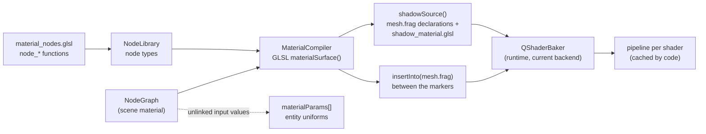

# Node materials

Materials are node graphs, edited in the **Shading** workspace (tab at the right end of the
menu bar). A material lives in the scene's library and any number of entities can use it;
an entity without one keeps its own color, roughness and metallic.

An entity has one **material slot** per submesh of its mesh: a glTF file gets a submesh
per material, an OBJ one per `usemtl`, primitives have one. When there are several, a
slot chooser appears under the material combo box in the Nodes panel.

## Using them

1. Switch to **Shading**: the node editor takes the right side, the scene stays centered on
   the left, the assets stay at the bottom.
2. Select a mesh (click it in the viewport) and press **+** in the Nodes panel: it gets a new
   material, starting from its current look. The combo box assigns any existing material
   to the selected entity, or **None**.
3. Edit the graph:

| Action | How |
|---|---|
| Add a node | Right click on the canvas, or Shift+A |
| Link | Drag from an output to an input (or the other way) |
| Unlink / relink | Drag a linked input away: drop it on another input, or in the void |
| Edit values | Select a node: its unlinked inputs appear under the canvas (drag the label to scrub) |
| Move, select | Drag nodes; drag on empty space for a rubber band |
| Delete | Delete or X (the Material Output stays) |
| Pan, zoom, frame | Middle drag, wheel, F |
| Add an image | Drop image files from Assets (or the file manager) on the canvas: an Image Texture node each; dropped on a node with an image input, it becomes that node's image |

Everything is undoable. Errors (a graph without output, a shader that doesn't compile, an
image that can't be loaded) show in red at the top of the panel; meanwhile the entities
fall back to their own values.

### Textures

The **Image Texture** node samples an image at the mesh's UVs (or at its `uv` input when
linked, e.g. from **Texture Coordinate**). With the node selected, the panel shows its
image: click it to choose another, **x** removes it, and **Color / Data** says how to
read it:

- **Color**: an sRGB image (base color, emission). Sampled through an sRGB texture
  format, so the shader gets linear values.
- **Data**: values used as they are (normal, roughness, metallic, occlusion maps). Images
  whose file name says so (`normal`, `rough`, `metal`, `orm`, `_ao`...) start as Data.

Images load in the background: the material is drawn at once with a plain fallback
(white, or what the node declares), and the texture appears when it's ready. Supported:
what Qt reads (PNG, JPEG, BMP...), up to 8192 pixels (larger ones are scaled down). A
material can use up to 8 images. Paths are saved relative to the scene file.

### Alpha

The Material Output's **alpha** input (0..1) is used as the material's **alpha mode**
says, chosen in the row under the material combo box:

| Mode | Surface | Shadow |
|---|---|---|
| Opaque | alpha is ignored | solid |
| Clip | pixels with alpha below the **cutoff** are cut away, the rest is opaque (leaves, fences, chain links) | the same holes |
| Blend | see-through by its alpha (glass, smoke, decals): drawn after the opaque meshes, far to near, blended over them | translucent: lets 1 − alpha of the light through (alpha 0.5: half of it), layers multiply |

Link an Image Texture's `alpha` output (the image's alpha channel) into it, or type a
value. For blend materials, **absorption** (0..1, default 0) is the share of light a fully
opaque surface absorbs instead of letting through: it shapes the translucent shadow
(`shadow_material.glsl` decides how), so a clear white glass can still cast a faint one.

Blend surfaces don't write depth, so they never hide each other; they are sorted per
entity, not per triangle, so two crossing glass panes can show in the wrong order. Closed
meshes (a glass cube or ball) draw their far side first, then their near side.

### Subsurface

**subsurface** (0..1, default 0) is the share of the diffuse light that scatters inside the
surface instead of bouncing off it (skin, wax, leaves, marble, milk), **subsurfaceColor** the
tint it picks up, **subsurfaceRadius** how far it travels inside, in world units. They take
effect once `mesh.frag`'s light loop uses them (see [below](#subsurface-in-meshfrag)).

### Importing glTF materials

Importing a glTF file (File > Import, double click or drag from Assets) adds its materials
to the scene as node graphs and puts them in the new entity's slots, in one undo step:

| glTF | Graph |
|---|---|
| base color texture x factor | Image Texture (Color) x Multiply Color, into Base Color |
| metallic-roughness texture | Image Texture (Data) -> Separate RGB: G x roughness factor, B x metallic factor |
| occlusion texture | R of its Image Texture (packed ORM images share one node) |
| normal texture | Image Texture (Data) -> Normal Map node, into Normal (left unlinked while there is no Normal Map node, see below) |
| emissive texture x factor | Image Texture (Color) x Multiply Color, into Emission |
| `alphaMode` MASK / BLEND, `alphaCutoff` | alpha mode Clip / Blend and its cutoff; base color texture's alpha x base color factor's alpha, into Alpha (OPAQUE leaves alpha unlinked) |

Factors of 1 add no Multiply node; without a texture the factor is the output's value.
Images inside the file (`.glb`, data URIs) are referenced as `model.glb#image<N>`.
Not imported: texture transforms, second UV sets. Materials imported before alpha was
supported stay opaque: set their mode by hand, or import the file again.

## How it works



- The compiler walks back from the Material Output, writes one call per node in dependency
  order, and assigns the output's inputs to a `Surface`.
- **Values are not in the code**: each unlinked input gets a slot of `materialParams[]`
  (a vec4 in the entity's uniform buffer, up to 32). Scrubbing a value only updates the
  buffer; the shader is compiled again only when nodes or links change, and compiled
  shaders are cached by their code.
- **Images are not in the code either**: each image input is a sampler slot,
  `materialTexture0..7` (bindings 11–18 of the entity's binding set), so picking another
  image only binds another texture. Textures are cached by (image, Color/Data) and shared.
- Unlinked inputs declared with `expr(...)` get that GLSL expression (the Image Texture's
  `uv` is `v_uv`; the output's `normal` is `normalize(v_normal)`).
- Ports of different types are converted when linked: a float fills a vec2 or vec3; a
  vec3 gives a float as its luminance and a vec2 as `.xy`; a vec2 gives a float as `.x`
  and a vec3 as `(x, y, 0)`.
- Colors are sRGB in the editor and arrive linear in the shader.
- Clip and blend materials also get a **shadow variant**: the declarations of `mesh.frag`
  (everything above the begin marker), the same generated code, and the `main()` of
  `shadow_material.glsl`, which discards what the material cuts away and, for blend,
  writes the light let through and the depth. Compiled only for materials that need it.
- The Renderer sets the pipelines from the alpha mode: blend materials draw with
  blending and without depth writes, after the others, sorted far to near.

## Writing nodes (Author)

A node type is a GLSL function in `src/engine/render/shaders/material_nodes.glsl`; no C++
needed. Its parameters are the ports (plain = inputs, `out` = outputs; `float`, `vec2` or
`vec3`, and `sampler2D` for image inputs; the signature on one line), and `// @` comments
right above it describe it:

```glsl
// @node Fresnel Mix (Color)              title (category in the Add menu)
// @param a 0.8 0.8 0.8 color             default; `color`: a vec3 shown as a color
// @param b 0.1 color                     one number fills all three
// @param power 5 range(0.5, 10)          slider limits for the value editor
// @param result color
void node_fresnel_mix(vec3 a, vec3 b, float power, out vec3 result)
{
    vec3 N = normalize(v_normal);
    vec3 V = normalize(cameraPos.xyz - v_world);
    result = mix(a, b, pow(1.0 - max(dot(N, V), 0.0), power));
}
```

- `fixed` makes an input a setting on the node (no socket), like the Value node's number.
- `expr(<glsl>)`: unlinked, the input is that expression (no value to edit), e.g.
  `// @param uv expr(v_uv)`.
- `sampler2D` inputs are images picked on the node (never linked). Their `@param` takes the
  fallback sampled without an image, `white` (default), `black`, `gray` or `normal`, and
  `linear` to default to Data (`normal` implies it):

```glsl
// @node Triplanar (Texture)
// @param image gray linear
// @param scale 1
void node_triplanar(sampler2D image, float scale, out vec3 color) { ... }
```

- The functions are pasted above `materialSurface()` in `mesh.frag`, so they can use what
  `mesh.frag` declares before the material markers: `v_world`, `v_normal`, `v_uv`,
  `v_tangent`, the uniforms, the environment and shadow maps, `PI`.
- A malformed node is skipped and its error shows in the Nodes panel; `tst_material`
  checks that the shipped library has no errors and that a graph using it compiles with the
  real `mesh.frag`.

### Hooking mesh.frag up

`mesh.frag` declares `struct Surface`, `materialParams[]`, and a default
`materialSurface()` between `//@material-begin` and `//@material-end` (keep the markers).
`main()` must take the surface from it, instead of the entity values:

```glsl
Surface surf = materialSurface();
vec3 albedo = surf.baseColor;
float roughness = max(surf.roughness, 0.045);
float metallic = surf.metallic;
```

`Surface` also carries `normal` (world space, normalized: what normal maps bend; default
the interpolated vertex normal), `occlusion` (0..1, 1 = none) and `emission` (linear), plus
`alpha`, `absorption` and the subsurface fields (sections below).
Until `main()` uses them they have no effect: `N` from `surf.normal` (keeping the
two-sided flip), the ambient terms times `surf.occlusion`, `surf.emission` added to the
result.

New surface fields are added to `Surface`, to the default `materialSurface()`, and as
inputs of the Material Output node (`outputNode()` in `nodelibrary.cpp`).

### Alpha in mesh.frag

`surf.alpha` arrives with the mode in the entity uniforms: `material.z` is the cutoff
(clip materials only, 0 otherwise), `material.w` the mode (0 opaque, 1 clip, 2 blend).
Until `main()` uses them, clip materials look opaque (their shadows already have the
holes) and blend ones look opaque too:

- **Clip**: `if (surf.alpha < material.z) discard;` near the top of `main()` (harmless
  for the other modes, whose `z` is 0).
- **Blend**: the pipeline blends premultiplied color, `result = src.rgb + (1 - src.a) *
  dst.rgb`, so write `vec4(color * alpha, alpha)` for blend and alpha 1 otherwise. Which
  terms to scale is a shading choice: light a clear surface still reflects (specular,
  the environment's reflection) can stay unscaled, so glass keeps its highlights.
- **Translucent shadows**: blend materials don't write the depth atlases, so `Shadow()`
  doesn't see them yet. They are in `shadowTranslucency` (see the comment above it in
  `mesh.frag` and [rendering.md](rendering.md#translucent-shadows)): where the receiver is
  farther from the light than the stored depth, multiply its light by the stored rgb.

### Subsurface in mesh.frag

`surf.subsurface`, `surf.subsurfaceColor` and `surf.subsurfaceRadius` are meant for the
light loop in `main()`, where each light's direction, radiance and shadow are at hand (node
functions can read `lights[]`, but not `Shadow()`, which is declared after the material
block). Cheap raster approximations, which combine:

- **Wrap lighting**: diffuse from `(dot(N, L) + w) / (1 + w)` instead of `NdotL`, tinted by
  the subsurface color past the terminator.
- **Back light**: light coming through the object toward the viewer,
  `pow(max(dot(V, -(L + N * distortion)), 0), power)`.
- **Thickness**: the distance light traveled inside, from the shadow map
  (`dReceiver - dBlocker` in `Shadow()`), attenuating the back light as
  `exp(-thickness / subsurfaceRadius)`.

### Normal maps

Meshes carry a tangent per vertex (from the glTF file, or computed from the UVs), and
`mesh.frag` receives it as `v_tangent`: `xyz` along +u in world space, `w` the handedness,
so `bitangent = cross(v_normal, v_tangent.xyz) * v_tangent.w` (glTF convention, OpenGL-style
green-up normal maps). The glTF importer links normal maps through a node with this
signature, when the library has it:

```glsl
// color: the normal map texel (0..1, Data); strength: glTF's scale
// normal: world space, normalized, for Material Output's normal
void node_normal_map(vec3 color, float strength, out vec3 normal)
```
