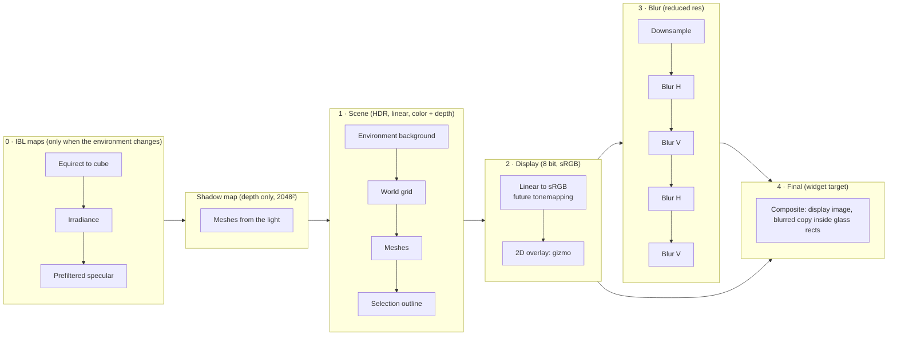

# Rendering

All rendering goes through **QRhi**, Qt's abstraction over Direct3D 11/12, Vulkan, Metal
and OpenGL. The default backend on Windows is Direct3D 11; another one can be chosen with
`Viewport::setApi()` before the window is shown.

`Renderer` (`engine/render/renderer.h`) needs only a `QRhi` and a render target, not a
widget: the editor viewport is one user, an offline renderer could be another.

```cpp
renderer.initialize(rhi, target);   // first frame, and whenever the target or QRhi changes
renderer.render(cb, target, camera, scene, selectedEntity);
renderer.release();                 // when the QRhi goes away
```

## The frame



| Pass | Target | Shaders | Notes |
|---|---|---|---|
| IBL maps | environment cubemaps, BRDF LUT | `cube.vert` + `equirect_to_cube.frag`, `irradiance.frag`, `prefilter.frag`; `fullscreen.vert` + `brdf_lut.frag` | Only when the environment's source changes (the LUT once): see [Image-based lighting](#image-based-lighting). |
| Shadow map | shadow map (depth) | `shadow.vert` + `shadow.frag` | Every visible mesh's depth from the shadowed directional light; see [Shadows](#shadows). Always cleared, drawn only when a light casts shadows. |
| Background | scene (RGBA16F) | `background.vert` + `background.frag` | Only when the Environment's `background` is on: the environment in each view ray's direction. |
| Grid | scene | `fullscreen.vert` + `grid.frag` | Fullscreen triangle; each pixel intersects its view ray with y = 0. No depth write: it's the background. Premultiplied alpha: opaque with its own sky, or only the lines over an environment background. Colors converted to linear on the CPU. |
| Meshes | scene | `mesh.vert` + `mesh.frag` | Depth tested, two-sided, Cook-Torrance (GGX) shading with the scene lights and the environment maps. Writes linear values (can exceed 1). |
| Outline | scene | `outline.vert` + `outline.frag` | Selected entity only. "Inverted hull": back faces pushed outwards in screen space, front faces culled. |
| Display | display (RGBA8) | `fullscreen.vert` + `display.frag` | Converts the linear HDR scene to sRGB for the screen. Exposure and tonemapping go here: `params.x` = exposure (EV), `params.y` = operator index (0 none, 1 Reinhard, 2 ACES, 3 AgX), set with `Renderer::setDisplayParams()` from the editor's `DisplaySettings`. |
| Overlay | display | `overlay.vert` + `overlay.frag` | Triangles in widget pixels with premultiplied alpha (the gizmo), in display colors: interface, so exposure/tonemapping never touch it; still blurred behind panels. |
| Downsample | blur A | `downsample.frag` | Average of 4 bilinear taps (16 texels) of the display image. |
| Blur ×4 | B, A, B, A | `blur.frag` | Separable 9-tap Gaussian with 5 bilinear fetches; two H+V iterations; `params.z` scales the sample spacing. |
| Composite | widget target | `composite.frag` | Display image everywhere; the blurred texture inside the glass rectangles (rounded-box SDF, anti-aliased edge). No color conversion. |

Color spaces: everything up to the display pass is **linear** (16-bit float, values above
1 allowed); from the display pass on it's **display sRGB** (8 bit, 0..1). Blurring after
the display conversion keeps the glass consistent with what's on screen and lets the blur
textures stay 8-bit.

Resources:

- Uniform buffers are `Dynamic` and rewritten every frame; each pass in a frame uses its
  own buffer (a dynamic buffer must not be updated twice in one frame).
- Each entity with a mesh has its own uniform buffer and binding set; meshes are cached
  by `Mesh*` and released when no entity uses them any more.
- The scene lights go in one buffer per frame (binding 1 of every mesh binding set):
  up to `Renderer::MaxLights` (8) enabled lights, each as position + type, direction and
  linear color + intensity (see the `Light` block in `mesh.frag`). A scene with no enabled
  light gets one default sun, so older scenes and empty ones stay visible.
- The environment goes in one more buffer (binding 2: rotation and parameters) and three
  textures (bindings 3–5: irradiance, prefiltered, BRDF LUT), shared by every mesh.
- Shadows: binding 6 (light matrices and parameters) and 7 (the shadow map). The shadow
  pass has its own binding sets (entity and shadow uniforms only), since the scene's ones
  sample the texture it writes.
- Size-dependent textures are recreated on resize. Render pass descriptors are created
  once and reused, so the pipelines built with them stay valid.

The renderer reports per-frame numbers in `FrameStats` (draw calls, passes, triangles,
meshes), shown by the stats overlay (F12).

## Image-based lighting

`IblMaps` (`src/engine/render/iblmaps.h`) turns the environment into the maps the shaders
sample, on the GPU. The source is the first enabled `Environment` in the scene: its
equirectangular `.hdr` image (downscaled to at most 4096 pixels wide) or, without one, a
sky/ground gradient made on the CPU; a scene without an Environment uses the default
gradient, so the maps are always valid.

| Map | Size | Written by | Holds |
|---|---|---|---|
| environment | cube, 512, full mip chain | `equirect_to_cube.frag` | The source as a cubemap; mips generated for filtered sampling |
| irradiance | cube, 32 | `irradiance.frag` | Diffuse lighting per normal, cosine-weighted and divided by π |
| prefiltered | cube, 128, 5 mips | `prefilter.frag` | Specular reflection, roughness = mip / 4 |
| BRDF LUT | 2D, 256 | `brdf_lut.frag` | Split-sum scale and bias for F0, per (N·V, roughness) |

All are RGBA16F. The maps are recomputed only when the source changes (image path, or the
gradient colors when there's no image): 6 + 6 + 30 passes, plus the LUT once at startup.
Intensity, rotation and background blur are uniforms, so changing them costs nothing.

Each cube pass is a fullscreen triangle per face (and per mip) drawn with `cube.vert`,
which hands the fragment shader `v_dir`, the direction through the texel, in the
standard cubemap face order and orientation, so `texture(cube, dir)` later reads what was
written for `dir`. The equirectangular image has V = 0 at the top row (straight up, +Y)
and wraps around in U.

The Environment entity's rotation turns the environment: shaders sample the maps with
`mat3(envRotation) * dir` (`toEnvironment()` in `mesh.frag`), where `envRotation` is the
inverse of the entity's rotation. Its position doesn't matter.

## Shadows

One directional light casts shadows: the first enabled one with `shadows` on (in a scene
without lights, the default sun). Point lights don't cast shadows yet.

- **Shadow map**: a 2048² depth texture (`D32F`, or `D24`/`D16` where unsupported),
  rendered with no color target before the scene pass.
- **Light view**: an orthographic projection along the light's direction that covers the
  bounding sphere of every visible mesh. It doesn't depend on the camera, so shadows
  don't move while orbiting; a larger scene spreads the same texels over more space
  (cascades are on the roadmap).
- **Bias**: the shadow pass uses a slope-scaled depth bias (`kShadowSlopeBias` in
  `renderer.cpp`), which removes most acne; the shader can add a normal offset on top.
- **Sampling**: `mesh.frag` gets `shadowMatrix`, which turns a world position straight
  into `(uv, depth)` of the shadow map on every backend (texture orientation and clip
  depth range already handled), and the map through a comparison sampler
  (`sampler2DShadow`): `texture(shadowMap, vec3(uv, depth))` is 1 when lit, 0 in shadow,
  bilinearly blended across the 4 nearest texels. `shadowParams` holds whether shadows
  are on, the shadowed light's index in `lights[]`, the light's `softness` (filter radius
  in texels) and the texel size.

## Glass panels

Every direct child widget of the viewport with the dynamic property `glass = true` (the
floating panels, the command palette, the stats overlay) is a *glass rectangle*. Each
frame the viewport collects their geometry (in device pixels) and hands it to the
renderer with `setGlassRects()`; the composite pass shows the blurred display image inside them,
with corners of radius `glassRadius` (default 12). The widget itself is then drawn by Qt
on top, with a translucent background from the stylesheet.

The viewport redraws when a glass widget moves, resizes, shows or hides, so the blur
follows drags and animations. Up to 16 rectangles are supported (`MaxGlassRects`, which
must match `MAX_RECTS` in `composite.frag`).

## Coordinate conventions

QRhi backends disagree on two things, and the renderer handles both:

1. **Clip space Y**: up in OpenGL, Direct3D and Metal; down in Vulkan
   (`QRhi::isYUpInNDC()`).
2. **Framebuffer / texture Y**: origin at the bottom in OpenGL, at the top elsewhere
   (`QRhi::isYUpInFramebuffer()`).

Rules used in Lune:

- **Matrices** are built in the OpenGL convention (`QMatrix4x4::perspective`, `lookAt`).
  Mesh shaders multiply by `QRhi::clipSpaceCorrMatrix()`, which adapts them to the
  backend.
- **Fullscreen passes** use `fullscreen.vert`, or `fullscreen_flipped.vert` when
  `isYUpInNDC() != isYUpInFramebuffer()` (Direct3D, Metal), so that texture coordinate
  (0, 0) is the same corner on every backend and every pass samples what the previous
  one wrote.
- **The grid** unprojects pixels with the inverse view-projection; the NDC y sign is
  passed as a uniform for Vulkan.
- **Screen positions** (gizmo, glass rectangles, overlay) are in widget pixels with the
  origin at the top left, like Qt. `OrbitCamera::project()` and `screenRay()` convert
  between world and screen with the same convention.

## Shaders

GLSL 440 sources in `src/engine/render/shaders/`, compiled at build time by `qsb` (Qt
Shader Tools) into `.qsb` files with SPIR-V, GLSL 300 es/330, HLSL 5.0 and MSL 1.2, and
embedded as resources at `:/shaders/<name>.qsb`. The list is in `qt6_add_shaders()` in
the root `CMakeLists.txt`.

Uniform blocks use `std140`, binding 0; textures start at binding 1. Meshes use binding 1
for the lights block, 2 for the environment block, 3–5 for the environment maps, 6 for
the shadow block and 7 for the shadow map. A
block shared by several shaders must be declared identically in each (see `mesh.vert`,
`mesh.frag`, `outline.vert`, `outline.frag`, `shadow.vert`; `mesh.frag` and `background.frag` for
the environment block; `mesh.frag` and `shadow.vert` for the shadow block).

## Limits (current)

- No anti-aliasing on mesh edges (no MSAA yet).
- The grid doesn't hide the parts of meshes below the ground plane.
- The outline is designed for convex meshes centered on their origin.
- The selection outline is drawn in the HDR scene, so it will follow exposure.
- GPU timings aren't available: `QRhiWidget` doesn't expose the flag that enables GPU
  timestamps on its `QRhi`.
