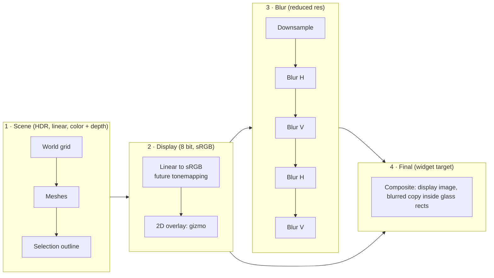

# Rendering

All rendering goes through **QRhi**, Qt's abstraction over Direct3D 11/12, Vulkan, Metal
and OpenGL. The default backend on Windows is Direct3D 11; another one can be chosen with
`Viewport::setApi()` before the window is shown.

`Renderer` (`engine/render/renderer.h`) needs only a `QRhi` and a render target, not a
widget: the editor viewport is one user, an offline renderer could be another.

```cpp
renderer.initialize(rhi, target);   // first frame, and whenever the target or QRhi changes
renderer.render(cb, target, camera, scene, selectedEntity);
renderer.release();                 // when the QRhi goes away
```

## The frame



| Pass | Target | Shaders | Notes |
|---|---|---|---|
| Grid | scene (RGBA16F) | `fullscreen.vert` + `grid.frag` | Fullscreen triangle; each pixel intersects its view ray with y = 0. No depth write: it's the background. Colors converted to linear on the CPU. |
| Meshes | scene | `mesh.vert` + `mesh.frag` | Depth tested, two-sided, key + fill light with a sky/ground ambient. Writes linear values (can exceed 1). |
| Outline | scene | `outline.vert` + `outline.frag` | Selected entity only. "Inverted hull": back faces pushed outwards in screen space, front faces culled. |
| Display | display (RGBA8) | `fullscreen.vert` + `display.frag` | Converts the linear HDR scene to sRGB for the screen. Exposure and tonemapping go here. |
| Overlay | display | `overlay.vert` + `overlay.frag` | Triangles in widget pixels with premultiplied alpha (the gizmo), in display colors: interface, so exposure/tonemapping never touch it; still blurred behind panels. |
| Downsample | blur A | `downsample.frag` | Average of 4 bilinear taps (16 texels) of the display image. |
| Blur ×4 | B, A, B, A | `blur.frag` | Separable 9-tap Gaussian with 5 bilinear fetches; two H+V iterations; `params.z` scales the sample spacing. |
| Composite | widget target | `composite.frag` | Display image everywhere; the blurred texture inside the glass rectangles (rounded-box SDF, anti-aliased edge). No color conversion. |

Color spaces: everything up to the display pass is **linear** (16-bit float, values above
1 allowed); from the display pass on it's **display sRGB** (8 bit, 0..1). Blurring after
the display conversion keeps the glass consistent with what's on screen and lets the blur
textures stay 8-bit.

Resources:

- Uniform buffers are `Dynamic` and rewritten every frame; each pass in a frame uses its
  own buffer (a dynamic buffer must not be updated twice in one frame).
- Each entity with a mesh has its own uniform buffer and binding set; meshes are cached
  by `Mesh*` and released when no entity uses them any more.
- Size-dependent textures are recreated on resize. Render pass descriptors are created
  once and reused, so the pipelines built with them stay valid.

The renderer reports per-frame numbers in `FrameStats` (draw calls, passes, triangles,
meshes), shown by the stats overlay (F12).

## Glass panels

Every direct child widget of the viewport with the dynamic property `glass = true` (the
floating panels, the command palette, the stats overlay) is a *glass rectangle*. Each
frame the viewport collects their geometry (in device pixels) and hands it to the
renderer with `setGlassRects()`; the composite pass shows the blurred display image inside them,
with corners of radius `glassRadius` (default 12). The widget itself is then drawn by Qt
on top, with a translucent background from the stylesheet.

The viewport redraws when a glass widget moves, resizes, shows or hides, so the blur
follows drags and animations. Up to 16 rectangles are supported (`MaxGlassRects`, which
must match `MAX_RECTS` in `composite.frag`).

## Coordinate conventions

QRhi backends disagree on two things, and the renderer handles both:

1. **Clip space Y**: up in OpenGL, Direct3D and Metal; down in Vulkan
   (`QRhi::isYUpInNDC()`).
2. **Framebuffer / texture Y**: origin at the bottom in OpenGL, at the top elsewhere
   (`QRhi::isYUpInFramebuffer()`).

Rules used in Lune:

- **Matrices** are built in the OpenGL convention (`QMatrix4x4::perspective`, `lookAt`).
  Mesh shaders multiply by `QRhi::clipSpaceCorrMatrix()`, which adapts them to the
  backend.
- **Fullscreen passes** use `fullscreen.vert`, or `fullscreen_flipped.vert` when
  `isYUpInNDC() != isYUpInFramebuffer()` (Direct3D, Metal), so that texture coordinate
  (0, 0) is the same corner on every backend and every pass samples what the previous
  one wrote.
- **The grid** unprojects pixels with the inverse view-projection; the NDC y sign is
  passed as a uniform for Vulkan.
- **Screen positions** (gizmo, glass rectangles, overlay) are in widget pixels with the
  origin at the top left, like Qt. `OrbitCamera::project()` and `screenRay()` convert
  between world and screen with the same convention.

## Shaders

GLSL 440 sources in `src/engine/render/shaders/`, compiled at build time by `qsb` (Qt
Shader Tools) into `.qsb` files with SPIR-V, GLSL 300 es/330, HLSL 5.0 and MSL 1.2, and
embedded as resources at `:/shaders/<name>.qsb`. The list is in `qt6_add_shaders()` in
the root `CMakeLists.txt`.

Uniform blocks use `std140`, binding 0; textures start at binding 1. A block shared by
several shaders must be declared identically in each (see `mesh.vert`, `mesh.frag`,
`outline.vert`, `outline.frag`).

## Limits (current)

- No anti-aliasing on mesh edges (no MSAA yet).
- The grid doesn't hide the parts of meshes below the ground plane.
- The outline is designed for convex meshes centered on their origin.
- No tonemapping yet: values above 1 are clipped in the display pass.
- The selection outline is drawn in the HDR scene, so it will follow exposure.
- GPU timings aren't available: `QRhiWidget` doesn't expose the flag that enables GPU
  timestamps on its `QRhi`.
