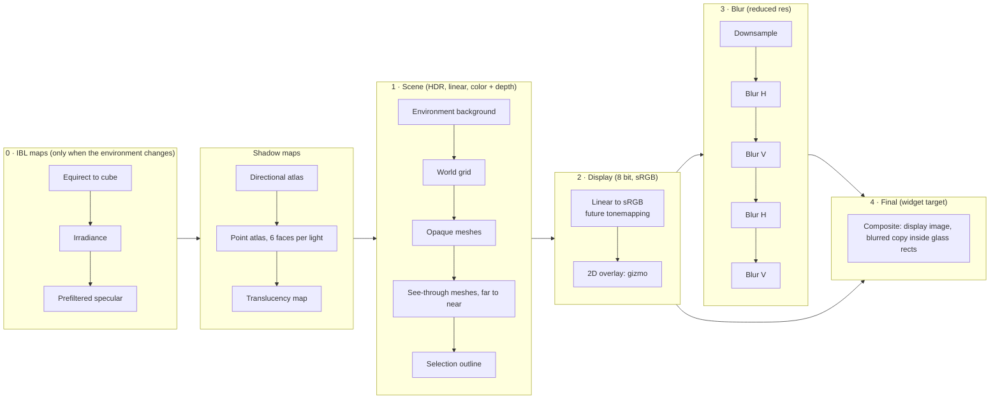

# Rendering

All rendering goes through **QRhi**, Qt's abstraction over Direct3D 11/12, Vulkan, Metal
and OpenGL. The default backend on Windows is Direct3D 11; another one can be chosen with
`Viewport::setApi()` before the window is shown.

`Renderer` (`engine/render/renderer.h`) needs only a `QRhi` and a render target, not a
widget: the editor viewport is one user, an offline renderer could be another.

```cpp
renderer.initialize(rhi, target);   // first frame, and whenever the target or QRhi changes
renderer.render(cb, target, camera, scene, selectedEntity);
renderer.release();                 // when the QRhi goes away
```

## The frame



| Pass | Target | Shaders | Notes |
|---|---|---|---|
| IBL maps | environment cubemaps, BRDF LUT | `cube.vert` + `equirect_to_cube.frag`, `irradiance.frag`, `prefilter.frag`; `fullscreen.vert` + `brdf_lut.frag` | Only when the environment's source changes (the LUT once): see [Image-based lighting](#image-based-lighting). |
| Shadow atlases | two depth atlases | `shadow.vert` + `shadow.frag`; `shadow_material.vert` + a material's shadow variant for clip materials | Every visible mesh's depth from each shadowed light, one tile (viewport) per view; see [Shadows](#shadows). Always cleared. |
| Translucency | translucency map (RGBA16F) | `shadow_material.vert` + a blend material's shadow variant; `shadow_front.vert` + `shadow_front.frag` | The light blend materials let through, and their nearest depth, per tile; see [Translucent shadows](#translucent-shadows). Then the front depth of every built-in caster in its own regions; see [Front depth](#front-depth). Always cleared. |
| Background | scene (RGBA16F) | `background.vert` + `background.frag` | Only when the Environment's `background` is on: the environment in each view ray's direction. |
| Grid | scene | `fullscreen.vert` + `grid.frag` | Fullscreen triangle; each pixel intersects its view ray with y = 0. No depth write: it's the background. Premultiplied alpha: opaque with its own sky, or only the lines over an environment background. Colors converted to linear on the CPU. |
| Meshes | scene | `mesh.vert` + `mesh.frag` | Depth tested, two-sided, Cook-Torrance (GGX) shading with the scene lights and the environment maps. One draw per submesh, each with its material slot's pipeline (node material or default) and binding set. Writes linear values (can exceed 1). Blend materials last, sorted far to near by entity, with premultiplied-alpha blending and no depth writes; closed meshes in two draws, back faces then front faces, so a glass cube's far side never blends over its near side. |
| Outline | scene | `outline.vert` + `outline.frag` | Selected entity only. "Inverted hull": back faces pushed outwards in screen space, front faces culled. Its own binding set per entity (entity uniforms only): on Direct3D 11 a binding set's registers follow the first pipeline that used it, and `mesh.frag` puts the entity block in another register. |
| Display | display (RGBA8) | `fullscreen.vert` + `display.frag` | Converts the linear HDR scene to sRGB for the screen. Exposure and tonemapping go here: `params.x` = exposure (EV), `params.y` = operator index (0 none, 1 Reinhard, 2 ACES, 3 AgX), set with `Renderer::setDisplayParams()` from the editor's `DisplaySettings`. |
| Overlay | display | `overlay.vert` + `overlay.frag` | Triangles in widget pixels with premultiplied alpha (the gizmo), in display colors: interface, so exposure/tonemapping never touch it; still blurred behind panels. |
| Downsample | blur A | `downsample.frag` | Average of 4 bilinear taps (16 texels) of the display image. |
| Blur ×4 | B, A, B, A | `blur.frag` | Separable 9-tap Gaussian with 5 bilinear fetches; two H+V iterations; `params.z` scales the sample spacing. |
| Composite | widget target | `composite.frag` | Display image everywhere; the blurred texture inside the glass rectangles (rounded-box SDF, anti-aliased edge). No color conversion. |

Color spaces: everything up to the display pass is **linear** (16-bit float, values above
1 allowed); from the display pass on it's **display sRGB** (8 bit, 0..1). Blurring after
the display conversion keeps the glass consistent with what's on screen and lets the blur
textures stay 8-bit.

Resources:

- Uniform buffers are `Dynamic` and rewritten every frame; each pass in a frame uses its
  own buffer (a dynamic buffer must not be updated twice in one frame).
- Each entity with a mesh has a uniform buffer and binding set per material slot
  (submesh): the same matrices, its material's values and textures. Slot 0's buffer also
  serves the shadow and outline passes, which draw the whole mesh (shadows: unless a slot
  has a clip or blend material; then each slot casts on its own, those with their slot's
  buffer and textures). Meshes are cached by `Mesh*` and released when no entity uses
  them any more.
- Vertices (`MeshVertex`, 48 bytes): position, normal, uv, tangent (xyz + handedness).
  UV (0, 0) is the top-left of an image (glTF convention; OBJ's v is flipped on import).
- Material textures: bindings 11–18 (`materialTexture0..7`), from `TextureCache`
  (`engine/render/texturecache.h`): images decoded on a worker thread, uploaded as RGBA8
  with mipmaps generated on the GPU, an sRGB format for Color images; until ready, a 1x1
  fallback. Unused slots bind white. A slot's binding set is rebuilt only when its
  textures change.
- The scene lights go in one buffer per frame (binding 1 of every mesh binding set):
  up to `Renderer::MaxLights` (8) enabled lights, each as position + type, direction and
  linear color + intensity (see the `Light` block in `mesh.frag`). A scene with no enabled
  light gets one default sun, so older scenes and empty ones stay visible.
- The environment goes in one more buffer (binding 2: rotation and parameters) and three
  textures (bindings 3–5: irradiance, prefiltered, BRDF LUT), shared by every mesh.
- Shadows: binding 6 (matrices and parameters), 7–10 (both atlases, each with a
  comparison and a raw-depth sampler) and 19 (the translucency map). The shadow passes
  have their own binding sets (entity uniforms and the tile's view matrix, at a dynamic
  offset), since the scene's ones sample the textures they write. Clip and blend
  materials cast with all of `mesh.frag`'s bindings (their shader has its declarations),
  with 1x1 stand-ins for the shadow maps, plus the view at binding 20.
- Size-dependent textures are recreated on resize. Render pass descriptors are created
  once and reused, so the pipelines built with them stay valid.

The renderer reports per-frame numbers in `FrameStats` (draw calls, passes, triangles,
meshes), shown by the stats overlay (F12).

## Image-based lighting

`IblMaps` (`src/engine/render/iblmaps.h`) turns the environment into the maps the shaders
sample, on the GPU. The source is the first enabled `Environment` in the scene: its
equirectangular `.hdr` image (downscaled to at most 4096 pixels wide) or, without one, a
sky/ground gradient made on the CPU; a scene without an Environment uses the default
gradient, so the maps are always valid.

| Map | Size | Written by | Holds |
|---|---|---|---|
| environment | cube, 512, full mip chain | `equirect_to_cube.frag` | The source as a cubemap; mips generated for filtered sampling |
| irradiance | cube, 32 | `irradiance.frag` | Diffuse lighting per normal, cosine-weighted and divided by π |
| prefiltered | cube, 128, 5 mips | `prefilter.frag` | Specular reflection, roughness = mip / 4 |
| BRDF LUT | 2D, 256 | `brdf_lut.frag` | Split-sum scale and bias for F0, per (N·V, roughness) |

All are RGBA16F. The maps are recomputed only when the source changes (image path, or the
gradient colors when there's no image): 6 + 6 + 30 passes, plus the LUT once at startup.
Intensity, rotation and background blur are uniforms, so changing them costs nothing.

Each cube pass is a fullscreen triangle per face (and per mip) drawn with `cube.vert`,
which hands the fragment shader `v_dir`, the direction through the texel, in the
standard cubemap face order and orientation, so `texture(cube, dir)` later reads what was
written for `dir`. The equirectangular image has V = 0 at the top row (straight up, +Y)
and wraps around in U.

The Environment entity's rotation turns the environment: shaders sample the maps with
`mat3(envRotation) * dir` (`toEnvironment()` in `mesh.frag`), where `envRotation` is the
inverse of the entity's rotation. Its position doesn't matter.

## Shadows

`ShadowMaps` (`src/engine/render/shadowmaps.h`) renders the shadow maps of every light
with `shadows` on, up to 4 directional and 4 point lights in scene order (the others light
without shadows; a scene without lights gets the default sun, which casts them).

| Atlas | Size | Tiles | Projection |
|---|---|---|---|
| directional | 4096² | 4 cascades per light: one light gets 2 × 2 tiles of 2048², more lights a row of 4 tiles of 1024² each | orthographic along the light, one per slice of the camera's view (see below) |
| point | 3072 × 2048 | 6 × 4 of 512², one row per light, one cube face (+X −X +Y −Y +Z −Z) per column | perspective from the light, a little wider than 90° (24 border texels, `pointShadowRange.zw` gives tan(fov/2) and the face size), far plane at the farthest mesh |

- **Passes**: one per atlas, one viewport per tile; each mesh is drawn once per tile.
- **Cascades** (directional lights): the camera's view is cut into 4 slices by distance,
  from the near plane to the farthest mesh, with splits that blend logarithmic and uniform
  spacing (`CascadeSplitBlend` = 0.75). Each slice gets the tile that covers its bounding
  sphere, so the nearest cascade has the smallest texels, however large the scene. The
  sphere doesn't change size when the camera turns and its center is snapped to whole
  texels, so shadow edges don't shimmer while orbiting. The depth range starts at the mesh
  nearest to the light, so casters outside the slice still cast into it.
  `mesh.frag` picks the cascade from the distance along the camera's view
  (`cascadeSplits`, `cameraForward`); in the last 15% of a cascade, a per-pixel noise moves
  a growing share of pixels to the next one, so the change of resolution isn't a visible line.
- **Point lights**: views don't depend on the camera; the far plane reaches the farthest mesh.
- **Format**: `D32F` (or `D24`/`D16` where unsupported).
- **Closed meshes** (`Mesh::closed`, watertight: computed when a mesh is built or imported)
  write only their back faces, as seen from the light. Their depth is that of the object's
  far side, which near a contact (a cube on the floor) is close to the receiver's, so a
  blocker search (PCSS) gives a penumbra that shrinks to the contact instead of measuring
  from the top of the object. Open meshes (the plane) are drawn two-sided. A mirrored model
  matrix (negative scale) flips which faces are culled.
- **Bias**: slope-scaled depth bias in the shadow passes: pushed away from the light for
  open meshes (removes most acne), pulled toward it for back faces (so a back face touching
  the floor doesn't leak a line of light along the contact). The shader can add a normal
  offset on top.
- **Sampling** (`mesh.frag`): `lightShadow[i]` gives the slot of `lights[i]` (−1 = no
  shadows), its `size` and `softness`. Per slot (and cascade), a matrix turns a world position into
  `(uv, depth)` in the atlas on every backend (texture orientation, clip depth range and
  tile placement handled; point faces need the division by w), plus the tile's uv
  rectangle and what's needed to turn depth back into distance. Each atlas is bound twice:
  through a comparison sampler (`sampler2DShadow`: 1 = lit, 0 = in shadow, blended across
  4 texels) and as raw depth (`sampler2D`, nearest), for blocker searches like PCSS.
- **OpenGL**: the same texture bound with two samplers may not get both sampler states
  there; Direct3D 11 (the default), Vulkan and Metal are fine.
- **Clip materials** (alpha mode Clip) are drawn into the atlases by their own pipeline,
  two-sided, running the material to discard the pixels it cuts away: their shadows have
  the same holes.

### Translucent shadows

Blend materials (glass, smoke) don't write the depth atlases. Their shadows go into the
**translucency map**: one RGBA16F texture at half the atlases' resolution
(`TranslucencyScale`): the directional atlas's region at the bottom (in QRhi's viewport
convention), the point atlas's above it, each with the same tiles as its atlas.
`translucencyDir` / `translucencyPoint` map an atlas uv to the map's uv. On their right,
two more regions hold the [front depth](#front-depth), so the texture is 3072 × 3072.

Cleared to 1 every frame, then every blend caster is drawn in every tile, two-sided, with
one blend state doing two things:

- **rgb** = dst × src: each layer multiplies the light by what it lets through
  (`shadow_material.glsl` writes 1 − alpha), so two alpha 0.5 panes let a quarter through,
  in any order.
- **a** = min(dst, src): the linear depth of the nearest translucent caster (directional:
  the atlas depth; point: distance along the face's axis / far), 1 where there's none.

A receiver uses rgb only where it's farther from the light than that depth, so the glass
doesn't shadow itself and what stands between it and the light isn't darkened. Clear
pixels (alpha below 1/255) are discarded, so they don't count as the nearest caster. Not
handled: a receiver between two translucent layers gets both.

### Front depth

Closed meshes write only their far side into the depth atlases (see above), so the
atlases say where light **leaves** a solid object, not where it enters. For thickness
(subsurface scattering) the translucency map has two more regions, at a quarter of the
atlases' resolution (`FrontDepthScale`), right of the translucency regions:
`frontDepthDir` / `frontDepthPoint` map an atlas uv there. In the same pass as the
translucency, every built-in caster is drawn again (`shadow_front.vert/.frag`) with the
opposite culling (closed meshes: front faces; open meshes: both), writing rgb = 1 (the
blend leaves it as it is) and the linear depth into a, which keeps the minimum: the
nearest surface to the light. Thickness at a receiver ≈ its distance along the light's
axis minus that depth (in world units after scaling by `dirShadowRange.x` or `far`).
Clip and blend materials are not drawn into it. Half-float precision: a step of about
1/2048 of the light's depth range.

Bindings: the map is binding 19 of the mesh binding set. With the 15 samplers before it,
`mesh.frag` uses 16, the most Direct3D 11 allows per shader stage: a new sampled texture in
`mesh.frag` needs another one removed or merged first.

## Viewport shading

`Renderer::setViewSettings()` (the shading menu at the top left of the viewport, View >
Shading, and every pass of an image render):

| Shading | What the Renderer does |
|---|---|
| Wireframe | Meshes as lines (`wireframe.vert/.frag`, polygon mode Line), see-through, light gray. Where lines aren't supported (OpenGL ES): like Clay. |
| Clay | Every slot with the default pipeline and one gray color (roughness 0.6, metallic 0): node materials are still compiled, so their errors show. |
| Unlit | `lightCount.y = 1` for `mesh.frag` (below). |
| Preview | No scene lights (`lightCount.x = 0`, not even the default sun) and no shadow views: the environment alone. |
| Rendered | Everything. |

`skybox` off hides the environment background (the grid's plain sky instead), and
`wireOverlay` draws dark, half-transparent edges over the shaded meshes (depth tested,
with a negative depth bias so they don't fight their own triangles).

**Debug views**: `lightCount.y` in the lights block tells `mesh.frag`'s `main()` what to
write instead of the shaded color (`DebugView` in `renderer.h`):

| View | `main()` writes |
|---|---|
| 1 Unlit | the base color, right after the surface (no lighting) |
| 2 Normals | the shading normal (normal maps, two-sided flip included) as 0.5 + 0.5 * N |
| 3 Depth | distance along the camera's view, 0 at the camera, 1 at the farthest mesh (`lightCount.z`, float bits, computed by the Renderer from the meshes' bounds) |
| 4 Direct | the light loop only: no environment, no emission |
| 5 Shadows | the lights' shadow factors averaged (translucent shadows keep their color), white = lit |

Views 1, 2, 3 and 5 are data: the Renderer sets exposure 0 and no tonemapping for them,
and `main()` writes each value through `debugValue()` (the inverse of the display's sRGB
encoding), so the 8-bit image holds the value itself (a normal pass reads back as the
normal). View 4 is an image and keeps the Display settings. Blend materials keep their
alpha in every view.

## Image renders

Render > Render Image (F4) and Render Passes (F6) draw the scene with the viewport's
camera (its lens shift dropped, so the image is centered) through `renderImages()`
(`imagerender.h`):

1. A new QRhi of the viewport's backend, its own `Renderer`, and an RGBA8 texture target
   of the requested size. Nothing is shared with the viewport, so its size, overlays and
   glass panels never reach the image, and its GPU state isn't touched.
2. Per pass, offscreen frames (`beginOffscreenFrame`): each pass is its own frame, since
   uniform buffers are rewritten every frame. Frames repeat while textures are still
   loading (at most 30 s), then the last one is read back: 8-bit, after exposure and
   tonemapping, without grid lines, overlay or outline.
3. Everything is released; the editor writes the PNG files and opens the result window.

Passes (`imagePasses()`): rendered, wireframe, clay, unlit, preview, rendered + wireframe,
normals, depth, direct light only, shadows only. Files:
`<folder>/<scene>_frame0001.png` (F4), `<scene>_frame0001_<pass>.png` (F6). The settings
(size, folder, background, passes) are saved in the scene's editor state.

## Glass panels

Every direct child widget of the viewport with the dynamic property `glass = true` (the
floating panels, the command palette, the stats overlay) is a *glass rectangle*. Each
frame the viewport collects their geometry (in device pixels) and hands it to the
renderer with `setGlassRects()`; the composite pass shows the blurred display image inside them,
with corners of radius `glassRadius` (default 12). The widget itself is then drawn by Qt
on top, with a translucent background from the stylesheet.

The viewport redraws when a glass widget moves, resizes, shows or hides, so the blur
follows drags and animations. Up to 16 rectangles are supported (`MaxGlassRects`, which
must match `MAX_RECTS` in `composite.frag`).

## Coordinate conventions

QRhi backends disagree on two things, and the renderer handles both:

1. **Clip space Y**: up in OpenGL, Direct3D and Metal; down in Vulkan
   (`QRhi::isYUpInNDC()`).
2. **Framebuffer / texture Y**: origin at the bottom in OpenGL, at the top elsewhere
   (`QRhi::isYUpInFramebuffer()`).

Rules used in Lune:

- **Matrices** are built in the OpenGL convention (`QMatrix4x4::perspective`, `lookAt`).
  Mesh shaders multiply by `QRhi::clipSpaceCorrMatrix()`, which adapts them to the
  backend.
- **Fullscreen passes** use `fullscreen.vert`, or `fullscreen_flipped.vert` when
  `isYUpInNDC() != isYUpInFramebuffer()` (Direct3D, Metal), so that texture coordinate
  (0, 0) is the same corner on every backend and every pass samples what the previous
  one wrote.
- **The grid** unprojects pixels with the inverse view-projection; the NDC y sign is
  passed as a uniform for Vulkan.
- **Screen positions** (gizmo, glass rectangles, overlay) are in widget pixels with the
  origin at the top left, like Qt. `OrbitCamera::project()` and `screenRay()` convert
  between world and screen with the same convention.

## Shaders

GLSL 440 sources in `src/engine/render/shaders/`, compiled at build time by `qsb` (Qt
Shader Tools) into `.qsb` files with SPIR-V, GLSL 300 es/330, HLSL 5.0 and MSL 1.2, and
embedded as resources at `:/shaders/<name>.qsb`. The list is in `qt6_add_shaders()` in
the root `CMakeLists.txt`.

Uniform blocks use `std140`, binding 0; textures start at binding 1. Meshes use binding 1
for the lights block, 2 for the environment block, 3–5 for the environment maps, 6 for
the shadow block, 7–10 for the shadow atlases, 11–18 for the material textures and 19 for
the translucency map (20: the shadow view of `shadow_material.vert`). A block shared by
several shaders must be declared identically in each (see `mesh.vert`, `mesh.frag`,
`outline.vert`, `outline.frag`, `shadow.vert`, `shadow_material.vert`; `mesh.frag` and
`background.frag` for the environment block).

## Limits (current)

- No anti-aliasing on mesh edges (no MSAA yet).
- The grid doesn't hide the parts of meshes below the ground plane.
- The outline is designed for convex meshes centered on their origin.
- The selection outline is drawn in the HDR scene, so it will follow exposure.
- GPU timings aren't available: `QRhiWidget` doesn't expose the flag that enables GPU
  timestamps on its `QRhi`.
